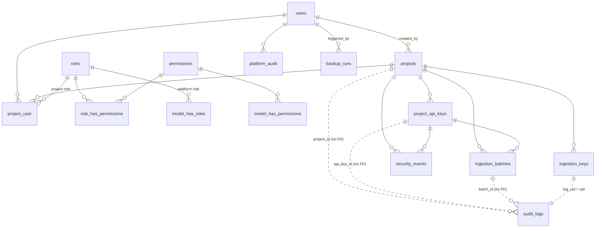

# مخطط قاعدة البيانات (Schema) - معتمد ومجمَّد

**الحالة:** مجمَّد منذ 2026-10-20: الجداول والأعمدة والفهارس والقيود والـ Triggers لم تتغير منذ ذلك التاريخ (تحقّقنا في 2026-11-12 بمقارنة `schema.sql` المولَّد من جديد بالنسخة المجمّدة: متطابقان عدا قائمة الأقسام الشهرية التي تتبع تاريخ التوليد). ما تغيّر داخل ملفات الـ Migrations بعد التجميد كود تشغيلي فقط (تنفيذ الأقسام عبر حساب الصيانة)، لا يغيّر المخطط · **الاعتماد:** اعتمدته صاحبة المشروع، مع القرارات D1–D19، في 2026-11-15
**المرجع النهائي:** [`database/schema/schema.sql`](../database/schema/schema.sql)، مولَّد من الـ Migrations على MariaDB 11.8 بالأمر `make schema-dump`. فيه 19 جدولًا و7 Triggers، ومختبر بالاستيراد في قاعدة فارغة.

القرارات وأسبابها في [decisions.md](decisions.md).

## مخطط العلاقات (ERD)

الخط المتقطع = علاقة منطقية **بدون** Foreign Key (بسبب التقسيم، D1).

## الجداول

| الجدول | الغرض | ملاحظات |
|---|---|---|
| `users` | مستخدمو لوحة التحكم | حقول MFA الخاصة بـ Filament 5، وقفل الحساب، وتاريخ تغيير كلمة المرور. لا يُحذف المستخدم، بل يُعطَّل |
| `password_reset_tokens` | استعادة كلمة المرور | من Laravel |
| `failed_jobs` | الـ Jobs الفاشلة نهائيًا | الطوابير والكاش والجلسات في Redis |
| `permissions`, `roles`, `model_has_*`, `role_has_permissions` | spatie/laravel-permission | جدول لكل Migration. أُضيف لـ `roles` عمود `scope`: `platform` أو `project` |
| `projects` | الأنظمة المرسِلة | `slug` فريد، `retention_days` بين 1 و3650 (CHECK)، أرشفة بدل الحذف، و**Trigger يمنع الحذف** |
| `project_user` | عضوية المستخدم في المشروع + دوره | `role_id` يشير إلى دور نطاقه `project` |
| `project_api_keys` | مفاتيح الـ API | `key_hash` (SHA-256) فريد، `hmac_secret` مشفّر، `environment`: production/staging، إلغاء بدل الحذف |
| `ingestion_batches` | تتبّع طلبات `/logs/batch` | `uid` (ULID) للمتابعة بعد الرد 202 |
| `ingestion_keys` | منع التكرار (D2) | `UNIQUE(project_id, external_id)`، append-only |
| **`audit_logs`** | السجلات | مقسَّم شهريًا، بدون FK، append-only. التفاصيل أدناه |
| `security_events` | محاولات الوصول المرفوضة | `project_id` و`api_key_id` قد تكون فارغة إن لم يُعرف المفتاح |
| `platform_audit` | تدقيق المنصة لنفسها | غير قابل للتعديل أو الحذف إطلاقًا |
| `saml2_tenants` | مزوّد الهوية للدخول الموحد SAML (D15) | صف واحد يكتبه `audit:saml-sync` من `.env` |
| `backup_runs` | سجل النسخ والأرشفة والاستعادة | الأنواع: full, incremental, binlog, logs_archive, app_files, restore_test, restore |

## تفصيل `audit_logs`

| العمود | النوع | ملاحظة |
|---|---|---|
| `id` | BIGINT UNSIGNED AI | داخلي فقط |
| `uid` | CHAR(26) | ULID يُولَّد في الـ API ويُعاد مع 202 (D4) |
| `project_id`, `api_key_id`, `batch_id` | BIGINT UNSIGNED | بدون FK (D1) |
| `external_id` | VARCHAR(191) NULL | التفرّد مضمون في `ingestion_keys` |
| `event`, `action` | VARCHAR | `user.updated` / `update` |
| `severity` | ENUM | info / warning / critical |
| `actor_type`, `actor_id`, `actor_name`, `actor_ip`, `user_agent` | VARCHAR | الفاعل |
| `subject_type`, `subject_id` | VARCHAR | الكيان المتأثر |
| `old_values`, `new_values`, `metadata`, `tags` | JSON | |
| `request_id`, `correlation_id` | VARCHAR(64) | ربط الأحداث المتسلسلة |
| `occurred_at` | DATETIME(3) | **عمود التقسيم**، وقت الحدث في المصدر (UTC) |
| `received_at` | DATETIME(3) | وقت قبول الـ API للطلب |
| `created_at` | DATETIME(3) | وقت التخزين الفعلي في الطابور |

**المفتاح الأساسي:** `(id, occurred_at)`، لأن قاعدة MariaDB تفرض وجود عمود التقسيم في كل مفتاح فريد.

**الفهارس:**
- `(uid)`
- `(project_id, occurred_at)`
- `(project_id, event, occurred_at)`
- `(project_id, actor_id, occurred_at)`
- `(project_id, subject_type, subject_id)`
- `(project_id, severity, occurred_at)`
- `(project_id, correlation_id)`
- `(project_id, external_id)`

**التقسيم:** `PARTITION BY RANGE (TO_DAYS(occurred_at))`
- `p_before`: ما قبل أول شهر.
- `pYYYYMM`: قسم لكل شهر.
- `p_future`: كل ما بعد آخر شهر.

الأمر `audit:partitions` يُشغَّل يوميًا ويُبقي 3 أشهر قادمة جاهزة دائمًا.

**الحماية:**
- Trigger يرفض أي `UPDATE`.
- Trigger يرفض `DELETE` إلا من الحساب `audit_archiver`.
- طبقة إضافية في الـ Model ترمي `AppendOnlyViolation` قبل الوصول للقاعدة.

**قاعدة للاستعلامات:** أي استعلام يجب أن يحتوي `project_id` ونطاقًا على `occurred_at`، حتى تفتح MariaDB الأقسام المطلوبة فقط (Partition Pruning).

## حسابات قاعدة البيانات

| الحساب | الصلاحيات | الاستخدام |
|---|---|---|
| `audit_app` | `SELECT, INSERT, UPDATE, DELETE, CREATE TEMPORARY TABLES, LOCK TABLES, EXECUTE` (بدون DDL، في التطوير والإنتاج) | التطبيق |
| `audit_archiver` | `SELECT, DELETE` | الأرشفة والحذف حسب مدة الاحتفاظ |
| `audit_backup` | `RELOAD, PROCESS, LOCK TABLES, BINLOG MONITOR` + `SELECT` فقط (لا يستطيع حذف الـ triggers) | Mariabackup |

في الإنتاج يُفصل حساب الـ Migrations عن حساب التشغيل (D6-2).

## قائمة مراجعة التجميد

- [x] حسم التعارضات D1 إلى D5 (حُسمت مع سادين في 2026-10-20؛ التفاصيل في decisions.md)
- [x] صلاحية Security Officer لقوائم الـ IP: `api_keys.manage_ips` (D6-6)
- [x] نافذة `occurred_at`: منفّذة (D6-4)
- [x] `migrate:fresh --seed` والاختبارات تنجح على بيئة نظيفة
- [x] توليد `database/schema/schema.sql` وإضافته للريبو
- [x] اعتماد صاحبة المشروع للمخطط والقرارات (2026-11-15). أي تغيير بعد أول نشر: Migration إضافية قابلة للتراجع فقط
